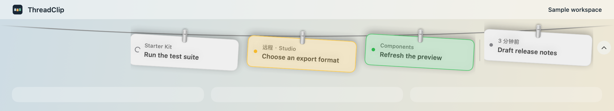
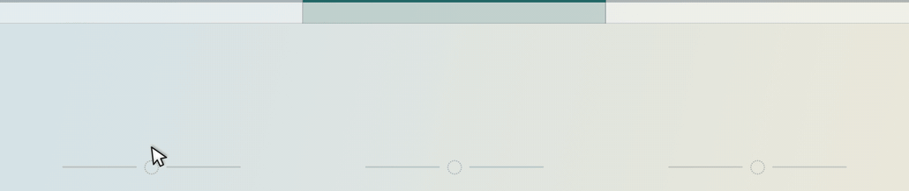
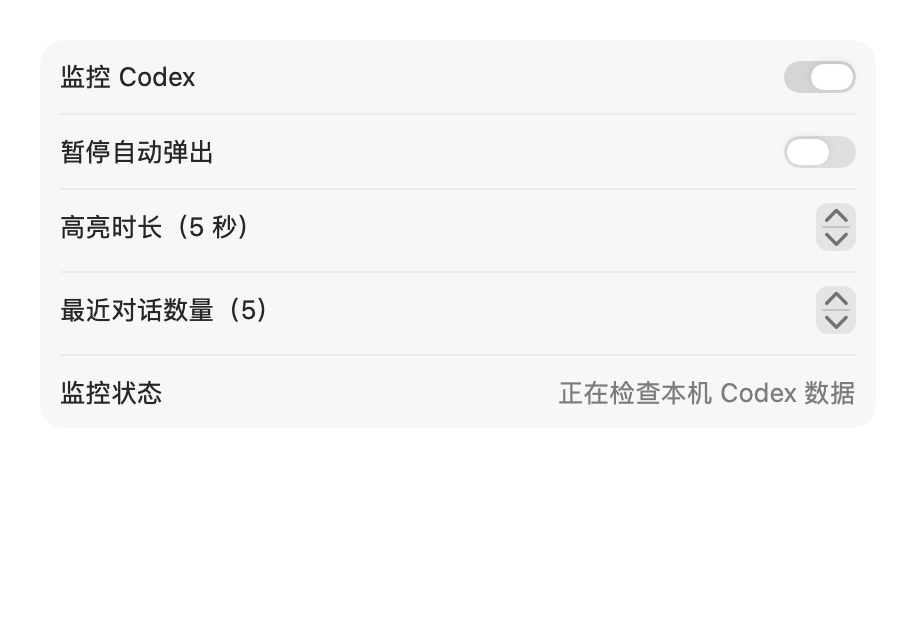

<p></p>

# ThreadClip

[简体中文](README.zh-CN.md) · [Download](https://github.com/CamusZ11/ThreadClip/releases/latest)

ThreadClip hangs your Codex chats from the top edge of your Mac. Hover over the middle third of the top edge to see what is running, what needs your input, and your recent chats. Click a card to open that chat in Codex.



## How it works

| Indicator | Meaning |
| --- | --- |
| Spinning ring | A Codex turn is running. |
| Yellow dot | Codex is waiting for a choice, an explicit reply, or another supported input request. |
| Green dot | A tracked turn finished. Opening the chat marks the card read after the app confirms the handoff. |
| Red dot | A tracked turn failed. |
| Gray dot | A recent chat. The thin divider sets these cards apart on the right. |



The screenshots and animation show the native macOS interface with sample chats. The current interface is in Simplified Chinese.

## Get started

1. Use macOS 14 or later and the Codex desktop app. [Releases](https://github.com/CamusZ11/ThreadClip/releases) contains the app ZIP. The ZIP is ad-hoc signed and has no Apple notarization. If macOS rejects the download, build a local copy using the commands below.
2. Open `ThreadClip.app` and hover over the middle third of the top edge of the main display. You can also choose **展开线程** from the ThreadClip menu bar icon.
3. Choose **设置…** from the same menu to change the recent-chat count, pause automatic pop-ups, or enable launch at login.



## Local and remote chats

- For local chats, ThreadClip reads Codex SQLite metadata and recent session events in read-only mode.
- For remote chats, it follows the state shared by your already connected Codex desktop app. Open a remote chat in Codex to load it. The observer uses the local desktop IPC connection and needs no SSH access.
- Device preferences and the minimal IDs needed to track turns and unread reminders stay on your Mac. ThreadClip does not write to Codex databases, submit answers or approvals, or send chat data to a ThreadClip server.
- Compatibility depends on Codex desktop's internal data formats. This release was tested with desktop build `26.1111.21308` on Apple silicon. Explicit text questions are detected heuristically. Local approval detection is unverified.

## Build from source

Install Xcode before building.

```sh
git clone https://github.com/CamusZ11/ThreadClip.git
cd ThreadClip
swift test
./scripts/build-app.sh
open build/ThreadClip.app
```

The build uses an ad-hoc signature by default. Set `APPLE_SIGNING_IDENTITY` to use your own signing identity. Set `THREADCLIP_ARCH=universal` to build for both Apple silicon and Intel.

## License and credits

ThreadClip's source is available under the [MIT License](LICENSE). Its rope, clips, and native panel behavior are adapted from [Tendedero by Alejandro Buján](https://github.com/alejandrobujan/tendedero/tree/e362da6d92e7ca9dd141de4017eae779dc1e4284). ThreadClip is an independent project for use with Codex.
