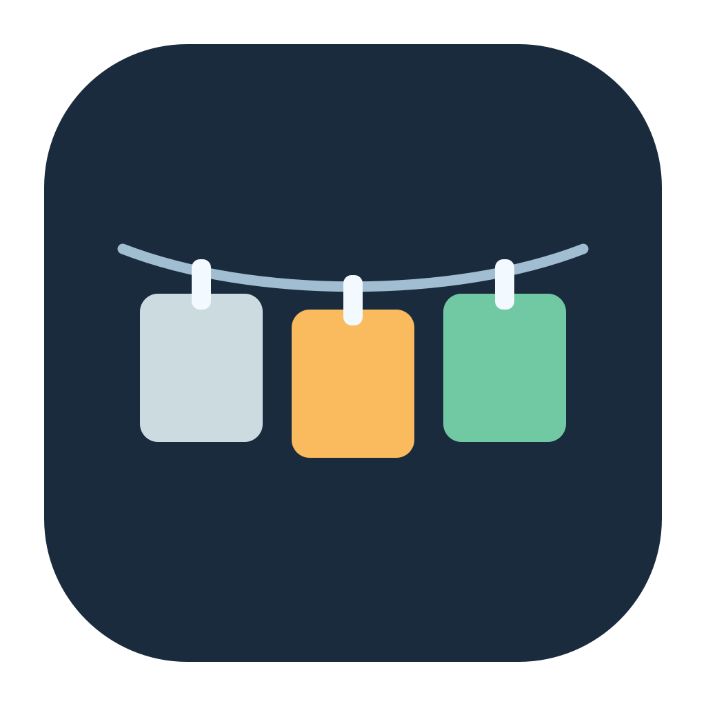
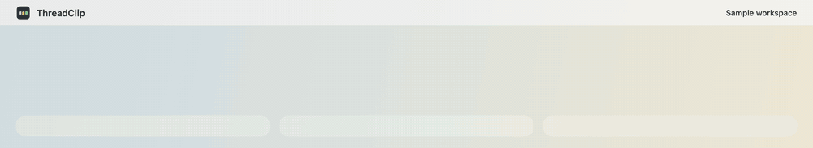

<p></p>

# ThreadClip

[简体中文](README.zh-CN.md) · [Download](https://github.com/CamusZ11/ThreadClip/releases/latest)

ThreadClip hangs your Codex chats from the top edge of your Mac. Hover over the middle third of the top edge to see what is running, what needs your input, and your recent chats. Click a card to open that chat in Codex.



## Get started

1. Use macOS 14 or later and the Codex desktop app. [Releases](https://github.com/CamusZ11/ThreadClip/releases) contains the app ZIP. The ZIP is ad-hoc signed and has no Apple notarization. If macOS rejects the download, build a local copy using the commands below.
2. Open `ThreadClip.app` and hover over the middle third of the top edge of the main display. You can also choose **展开线程** (Show chats) from the ThreadClip menu bar icon.
3. Choose **设置…** (Settings) from the same menu to customize the strip.

The screenshots and animation show the native macOS interface with sample chats. The current interface is in Simplified Chinese.

## Open, browse, and close the strip

- **Hover or use the menu bar.** With cards available, hover for about 0.25 seconds in the middle third of the main display's top edge. The left and right thirds are available for other apps. The menu bar also lets you show or hide the strip, pause or resume automatic pop-ups, open settings, and quit.
- **Stay in your current app.** The native panel is designed to appear in standard desktop and full-screen Spaces while leaving keyboard focus with your current app. Click a card when you want to switch to its chat in Codex.
- **Browse both groups.** Current and unread cards sit toward the center. Recent chats line up on the right, with a thin divider between the groups. Use the arrow buttons, scroll horizontally, or hold Shift while scrolling if the cards overflow. Hover over a card to see its full title, project, and status.
- **Dismiss the strip.** Use the button at the far right, **收起线程** (Hide chats) in the menu bar, or Esc while the pointer is over the strip. A strip opened by hovering also closes when you move away and there are no unread reminders.
- **Accessibility.** VoiceOver reads the project, title, status, and unread indicator for each card. With macOS Reduce Motion enabled, cards skip their arrival swing and the running indicator stays still.

Shading marks the hover zone in the demo. The pointer pauses at the left, middle, and right of the top edge, and the strip opens only in the middle third.


## Cards and reminders

| Indicator | Meaning |
| --- | --- |
| Spinning ring | A Codex turn is running. |
| Yellow dot | Codex needs your input. This covers supported choices and questions in standard and Plan modes, explicit requests for a reply in the final message, and supported remote approvals for commands, file changes, or permissions. |
| Green dot | A tracked turn finished successfully. |
| Red dot | A tracked turn ended in failure. The indicator follows the final turn result. |
| Gray dot | A recent chat. Local and loaded remote chats share this list, sorted by last update. Timestamps show “just now” or whole minutes, hours, and days. |


- **Get attention when needed.** New yellow, green, and red reminders can open the strip automatically. Unread reminders are saved locally and restored on relaunch. Browsing recent chats produces no new reminders.
- **Clear a waiting state by responding.** Structured questions can stay yellow after the turn finishes and while some answers are still pending. For an explicit question in the final message, sending a reply starts the next turn and clears the old reminder. An interrupted turn clears its running card.
- **Open the exact chat.** A card opens its local or remote chat in Codex, with the remote host included where applicable. When macOS accepts a jump from a recent or unread card, the strip normally closes. A newer reminder can keep it open.
- **Mark a reminder as read.** ThreadClip clears unread status after confirming the target chat opened in Codex. Automatic confirmation requires one visible Codex window. If the jump cannot be confirmed, retry or right-click the unread card and choose **标为已读** (Mark as read). A completed chat can then appear in Recents. Answer questions and handle approvals in Codex.

## Settings

| Control | What it does |
| --- | --- |
| **监控 Codex** (Monitor Codex) | Start or stop reading live Codex state. Turning it off keeps reminders already received. |
| **暂停自动弹出** (Pause automatic pop-ups) | Keep monitoring and recording reminders while you open the strip on demand. |
| **高亮时长** (Highlight duration) | Set the strong highlight on new completion and failure cards to 1–30 seconds. The default is 5 seconds. Unread yellow cards stay highlighted while waiting. |
| **最近对话数量** (Recent chat count) | Show 0–10 recent chats. The default is 5. Choose 0 to hide Recents. |
| **登录时启动** (Launch at login) | Ask macOS to start ThreadClip when you sign in. Confirm the login item in System Settings if macOS requests it. |
| **监控状态** (Monitoring status) | See the state of the Codex connection and any problems opening a chat or saving unread state. |


## Local and remote chats

- **Local chats.** ThreadClip reads Codex desktop metadata and recent session events in read-only mode.
- **Remote chats.** Open a chat in your already connected Codex desktop app. ThreadClip reads the loaded chat through the local desktop connection, with no separate SSH setup. If the connection drops, live remote cards are hidden until their status can be verified again. Previously received unread completion and failure reminders are retained.
- **On-device data.** ThreadClip reads Codex data locally and stores device preferences, tracking IDs, and unread state on your Mac. Replies and approvals are handled in Codex.
- **Compatibility.** ThreadClip relies on Codex desktop's internal data formats. It was tested with desktop build `26.1111.21308` on Apple silicon. Text-only follow-up questions are detected using rules, and local approval detection is unverified.

## Build from source

Install Xcode before building.

```sh
git clone https://github.com/CamusZ11/ThreadClip.git
cd ThreadClip
swift test
./scripts/build-app.sh
open build/ThreadClip.app
```

The build uses an ad-hoc signature by default. Set `APPLE_SIGNING_IDENTITY` to use your own signing identity. Set `THREADCLIP_ARCH=universal` to build for both Apple silicon and Intel.

To launch and reveal the strip directly from Terminal, run `open -a build/ThreadClip.app --args --reveal` from the project folder.

## License and credits

ThreadClip's source is available under the [MIT License](LICENSE). Its rope, clips, and native panel behavior are adapted from [Tendedero by Alejandro Buján](https://github.com/alejandrobujan/tendedero/tree/e362da6d92e7ca9dd141de4017eae779dc1e4284). ThreadClip is an independent project for use with Codex.
