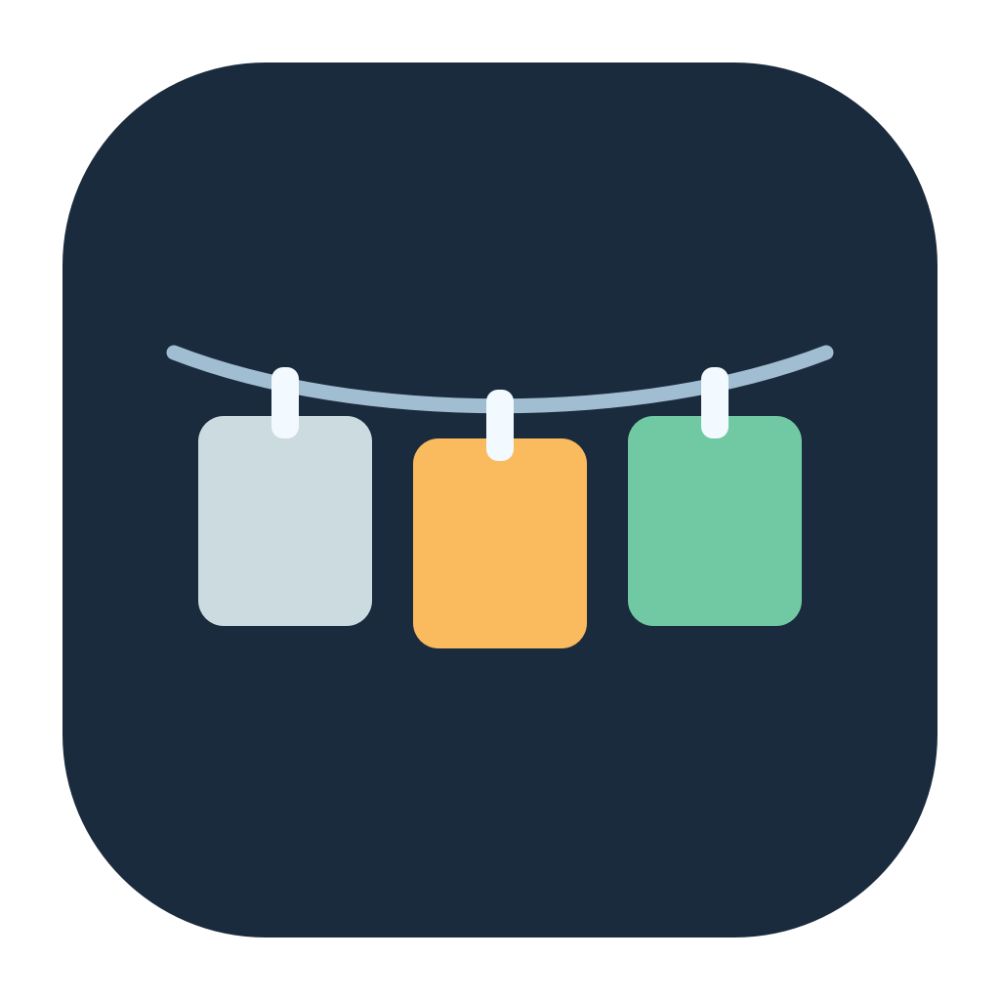
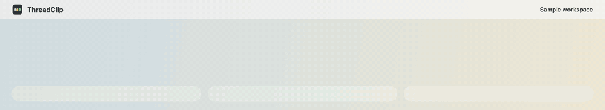
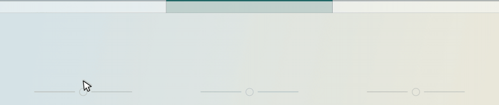
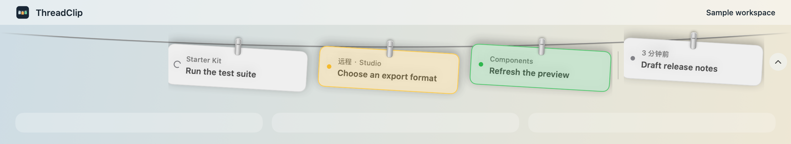
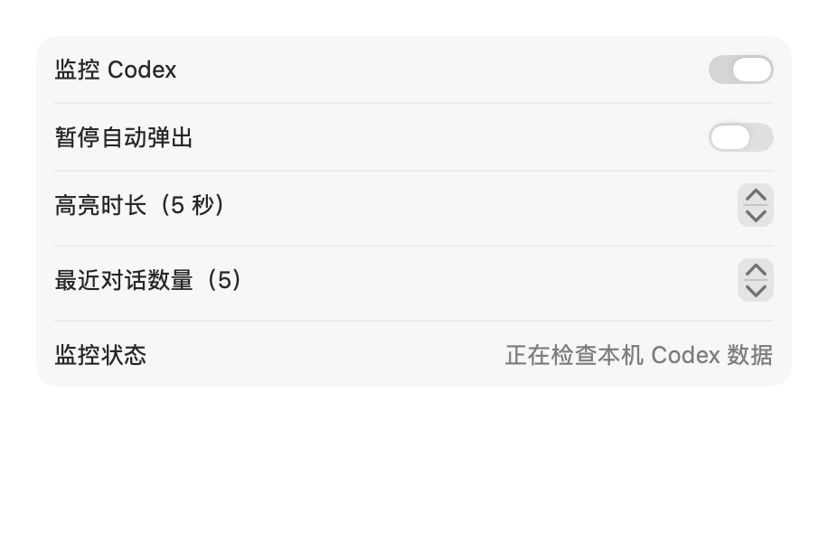

<p></p>

# ThreadClip · 会话夹

[English](README.md) · [下载](https://github.com/CamusZ11/ThreadClip/releases/latest)

ThreadClip 把 Codex 会话挂在 Mac 屏幕上沿。鼠标移到上沿中央三分之一，就能看到哪些会话在运行、哪些需要你操作，以及最近对话。点卡片即可回到 Codex 的对应会话。



## 开始使用

1. 准备 macOS 14 或更新版本，以及 Codex 桌面应用。从 [Releases](https://github.com/CamusZ11/ThreadClip/releases) 下载应用 ZIP。公开 ZIP 使用临时签名，未通过 Apple 公证。如果 macOS 拒绝打开下载的副本，可以按照下文从源码构建。
2. 打开 `ThreadClip.app`，把鼠标悬停在主显示器上沿的中央三分之一。也可以从 ThreadClip 菜单栏图标选择「展开线程」。
3. 从同一个菜单打开「设置…」，按需要调整悬挂条。

截图和动图使用示例会话，由 macOS 原生界面生成。当前应用界面为简体中文。

## 展开、浏览和收起悬挂条

- **悬停或用菜单栏打开。** 有卡片可看时，把鼠标放在主屏幕顶边中央三分之一约 0.25 秒。顶边左右各三分之一留给其他应用。菜单栏还可以收起悬挂条、暂停或恢复自动弹出、打开设置，以及退出应用。
- **继续操作当前应用。** 原生浮窗可显示在普通桌面和原生全屏空间，展开时将键盘焦点留给当前应用。点会话卡片即可切到 Codex。
- **浏览两组卡片。** 运行中和未读卡片集中在中间，最近对话靠右，中间以细线隔开。放不下时可点箭头、横向滚动，或按住 Shift 滚动。鼠标停在卡片上时，能看到完整标题、项目和状态。
- **收起。** 点击最右侧按钮、在菜单栏选择「收起线程」，或在鼠标位于悬挂条上时按 Esc。悬停展开且没有未读提醒时，移开鼠标也会自动收起。
- **辅助功能。** VoiceOver 可读出卡片的项目、标题、状态和未读提示。开启 macOS 的「减少动态效果」后，卡片入场时不摆动，运行圆环以静态方式显示。

动图用底色标出悬停区。鼠标依次停在顶边左、中、右三个位置，悬挂条只在中央三分之一展开。



## 卡片与提醒

| 图标 | 含义 |
| --- | --- |
| 转圈 | Codex 正在运行。 |
| 黄点 | Codex 在等你操作。覆盖普通模式和 Plan 模式下可识别的选择或提问、最终回复中的明确追问，以及支持的远程命令、文件变更和权限审批。 |
| 绿点 | 已跟踪的回合成功完成。 |
| 红点 | 已跟踪的回合最终失败。以整个回合的结果为准。 |
| 灰点 | 最近对话。合并本地与已加载的远程会话，按最后更新时间排列。时间显示为「刚刚」，或按整分钟、小时和天显示。 |



- **自动提醒。** 新的黄卡、绿卡和红卡可自动展开悬挂条。未读提醒保存在本机，重新启动后可以恢复。最近对话用于浏览，不会新增提醒。
- **答复后解除等待。** 结构化选择或提问可能在回合结束后继续等待，部分作答时仍保留黄卡。最终回复里的明确追问会在你答复并开始下一轮时解除。取消或中断回合会清除运行卡。
- **直达对应会话。** 点击卡片可打开本地会话或对应主机上的远程会话。点击未读或最近对话卡片，系统接收跳转后通常会收起悬挂条。期间有新提醒时，悬挂条会继续显示。
- **自动或手动标为已读。** 确认目标会话打开后，ThreadClip 才会自动保存已读。自动确认要求 Codex 只有一个可见窗口。跳转无法确认时，可以重试，或右键未读卡片选择「标为已读」。已读的完成会话可以进入最近对话。回答和审批在 Codex 里处理。

## 设置

| 设置 | 用途 |
| --- | --- |
| **监控 Codex** | 开始或停止读取 Codex 状态。关闭后保留此前收到的提醒。 |
| **暂停自动弹出** | 继续监听和记录提醒，按需手动或悬停展开。 |
| **高亮时长** | 设置新完成卡和失败卡的醒目高亮时长，范围 1–30 秒，默认 5 秒。未读黄卡在等待期间持续高亮。 |
| **最近对话数量** | 显示 0–10 条，默认 5 条。设为 0 可隐藏最近对话。 |
| **登录时启动** | 登录 macOS 后启动 ThreadClip。若系统要求确认，可从设置跳转到 macOS 的登录项页面。 |
| **监控状态** | 查看 Codex 监控情况，以及打开会话、保存未读状态时遇到的问题。 |



## 本地和远程会话

- **本地会话。** 通过只读方式读取 Codex 桌面应用的会话元数据和近期会话事件。
- **远程会话。** 在已连接 Codex Remote 的桌面应用里打开远程会话后，ThreadClip 通过本机连接读取已加载的内容，无需另配 SSH。断线期间暂时隐藏实时远程卡片，已经收到的完成或失败未读提醒会保留。
- **本机数据。** ThreadClip 在本机读取 Codex 数据，设备偏好、用于跟踪的标识和未读状态保存在你的 Mac 上。回答和审批由 Codex 处理。
- **兼容性。** ThreadClip 依赖 Codex 桌面应用的内部数据格式，已在 Apple 芯片上搭配桌面构建版本 `26.1111.21308` 验证。纯文字追问使用规则识别，本机审批检测仍待验证。

## 从源码构建

安装 Xcode 后运行以下命令。

```sh
git clone https://github.com/CamusZ11/ThreadClip.git
cd ThreadClip
swift test
./scripts/build-app.sh
open build/ThreadClip.app
```

构建默认使用临时签名。可以设置 `APPLE_SIGNING_IDENTITY` 使用自己的签名身份，或设置 `THREADCLIP_ARCH=universal` 构建同时支持 Apple 芯片和 Intel 的应用。

想从终端启动并直接展开悬挂条，可在项目目录运行 `open -a build/ThreadClip.app --args --reveal`。

## 许可与致谢

ThreadClip 源码采用 [MIT 许可](LICENSE)。悬挂绳、夹子和原生浮窗行为改编自 Alejandro Buján 的 [Tendedero](https://github.com/alejandrobujan/tendedero/tree/e362da6d92e7ca9dd141de4017eae779dc1e4284)。ThreadClip 是适用于 Codex 的独立项目。
